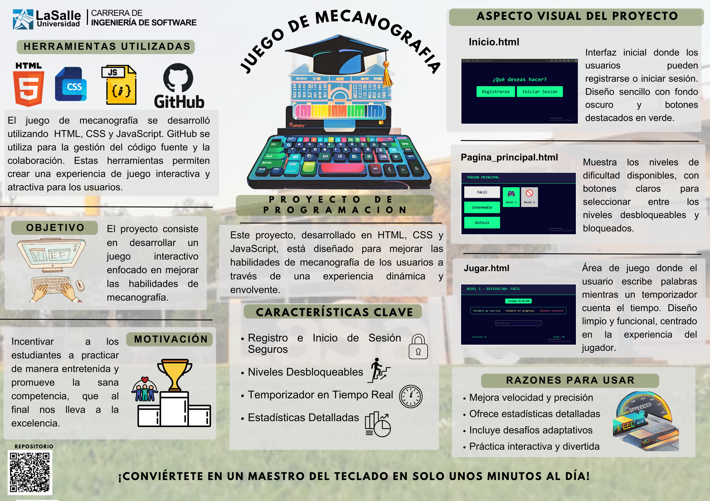

# Vectorcitos Run

Juego de mecanografía con niveles, estrellas y una escena 3D. · *A typing game with levels, stars and a 3D scene.*

Disponible en **español** e **inglés** (se elige solo por el idioma del navegador y se puede cambiar dentro del juego).



## Jugar / Run

```bash
npm install
npm run dev      # juego en http://localhost:5173
npm test         # reglas del juego
npm run build    # versión final en dist/
```

Tecnología: TypeScript, Vite y Three.js (3D). El sonido se genera en vivo con Web Audio.

## Cómo se juega
Escribe la frase completa, letra por letra, directamente con el teclado (sin cajas de texto; en celular, toca la pantalla para abrir el teclado). Una tecla equivocada no avanza. Las estrellas dependen de cuántas letras aciertas a la primera (95 % o más → 3★, 85 % o más → 2★, resto → 1★). Terminar un nivel abre el siguiente. El avance se guarda **en el dispositivo**, por jugador (nombre). No hay contraseñas ni servidor.

## Modos de juego
- **Niveles** (fácil, intermedio, difícil) y **Práctica** de teclas.
- **Reto diario:** tres frases (fácil, media, difícil), iguales para todo el mundo ese día (fecha UTC). Cuenta días seguidos.
- **Contrarreloj:** 60 segundos, frases sin fin. Cada letra acertada suma 10 puntos y cada error resta 5.
- Todas empiezan con cuenta regresiva (3, 2, 1, ¡YA!).

## Personaje, ambiente y cosméticos
- **Vectorcito 3D:** `public/models/vectorcito.glb` se generó con Higgsfield (modelo Meshy 7, imagen a 3D) a partir del dibujo `public/brand/vectorcito-front.png` y se redujo a 549 kB con `gltf-transform` (textura de 1024 px). `src/hero.ts` lo parte en cuerpo, brazos y piernas para animarlos y lo tiñe con un giro de color. Si el archivo no existe o falla, se dibuja un personaje sencillo.
  - Para cambiarlo: reemplaza el `.glb` y ajusta las medidas de `MODEL` (y los cortes de brazos y piernas) en `src/hero.ts`.
  - Se probó dar esqueleto y animación de correr con Higgsfield, pero el personaje es un bloque con extremidades diminutas y se deformaba; por eso se anima por partes.
- **Ambiente:** `src/world.ts`. Cada dificultad tiene su look: atardecer en el mar con islas y nubes (fácil), montañas nevadas con luna y aurora (intermedio), ciudad de neón con sol rayado (difícil) y teclas flotantes (práctica). Hay líneas de velocidad y, en computador, brillo de neón. En teléfonos se reduce el detalle para cuidar la batería.
- **Cosméticos:** `src/cosmetics.ts` (catálogo, precios y rareza) y `src/hero.ts` (modelos). Hay 14 accesorios, 5 colores y 3 estelas. Para añadir un accesorio: una entrada en el catálogo y su modelo en `rebuildAccessories()`.

## Móvil, tablet y app instalable
- **Detecta desde dónde se juega** (`src/device.ts`): teléfono, tablet o computador, sistema (iOS, Android, Windows, Mac, Linux) y si ya está instalado como app. El resultado queda en `<html data-kind data-touch data-os>` y el CSS se adapta.
- **Escritura táctil:** el teclado de pantalla se abre al tocar la frase. En pantalla táctil las letras se leen a medida que llegan (los teclados de teléfono mantienen la palabra "en composición"), y los errores hacen vibrar en Android.
- **Teclado de colores:** solo se muestra si se escribe con teclado físico (en tablets se activa al detectar una tecla física). La guía de dedos explica qué hacer en teléfono y en tablet.
- **Salir:** botón ✕ en el juego (en celular no hay tecla Esc). En horizontal, los teléfonos reciben un aviso para girar la pantalla.
- **App instalable (PWA):** `public/manifest.webmanifest` y `public/sw.js` (abre sin conexión; nunca guarda `/api/`). Chrome/Edge ofrecen "Instalar la app"; en iPhone y iPad se explica cómo con Compartir → Añadir a pantalla de inicio.
- **Iconos y vista previa:** icono provisional de Vectorcito (`favicon.svg`, `favicon.ico`, `apple-touch-icon.png`, iconos 192/512 y adaptable) y `og-image.jpg` para WhatsApp, Telegram, X, Facebook, Discord... Se regeneran con `node scripts/make-assets.mjs` (necesita Playwright). Los datos de la página están en `index.html`; si cambia la dirección del sitio, hay que actualizar sus enlaces absolutos (`og:url`, `og:image`, `canonical`).
- **Iconos:** paquete propio de 48 stickers generado con Higgsfield (hojas en `assets/icon-sheets/`). `python3 scripts/slice-icons.py` los recorta a `public/icons/*.webp`; `src/icons.ts` los usa con `ic("nombre")`.
- **Música:** cinco pistas instrumentales (menú, fácil, medio, difícil, práctica) en `public/audio/`, con bucle y fundido; si no cargan suena un arpegio generado en vivo.
- **Cosméticos:** catálogo en `src/cosmetics.ts` (rarezas por precio, pieza 3D de cada accesorio en `src/hero.ts`, acabados cromado/arcoíris, estelas con forma). La tienda deja probarse todo antes de comprar.
- **Guía de dedos:** foto de manos en `public/brand/manos.webp`.

## Ideas que vinieron del buzón
- **Guía de dedos:** pantalla "Cómo colocar los dedos" (la primera vez y desde el mapa) y un teclado en el juego con el color de cada dedo y la próxima tecla resaltada (`src/keys.ts`). Se puede apagar con el botón ⌨️.
- **Monedas, regalo diario y tienda:** cada partida da monedas; el regalo diario sube con la racha del reto diario; en la tienda se compran accesorios que se ven en la escena 3D. Para añadir un accesorio: una entrada en `src/cosmetics.ts` y su modelo en `src/hero.ts`.
- **Retar a un amigo:** al terminar un nivel o la contrarreloj, el botón 🤝 genera un enlace con tu marca (`#reto=...`). Quien lo abre juega lo mismo y ve quién ganó. No usa servidor.

## Buzón de sugerencias
Los jugadores escriben desde 💌 en el inicio o en el mapa. El mensaje va a `api/suggest.ts`, que lo guarda en un almacén **privado** de Vercel Blob (tope de 200 por día y campo trampa contra bots).
Para leerlos abre `https://TU-DOMINIO/api/inbox?key=TU_CLAVE`, donde la clave es la variable de entorno `ADMIN_KEY` del proyecto en Vercel. Con `&format=json` los obtienes como datos. Además de `ADMIN_KEY`, hace falta `BLOB_READ_WRITE_TOKEN`, que Vercel crea al conectar el almacén.

## Ranking y salas
En 🏆 el jugador decide (apagado por defecto) si su apodo y sus puntos del reto diario y de la contrarreloj aparecen en la tabla **mundial** y, si escribe un código de **sala**, en la tabla de esa sala. Un docente o grupo solo tiene que compartir un código (3 a 12 letras o números).
- No hay cuentas ni contraseñas: cada dispositivo genera un código privado y solo envía una huella suya. Cualquiera puede borrar sus marcas desde el mismo botón.
- Las marcas las envía el navegador, así que el servidor solo descarta valores absurdos (`api/_rank.ts`): no impide hacer trampa.
- Cada marca vive en un archivo de Vercel Blob cuyo nombre contiene el puntaje (`api/rank.ts`), sin base de datos.
- Moderación: `https://TU-DOMINIO/api/rank?remove=ID&key=TU_CLAVE` borra a un jugador de todas las tablas (el `ID` sale en la respuesta JSON de `/api/rank?board=daily`).

## Estructura

| Archivo | Qué hace |
|---|---|
| `src/engine.ts` | Reglas: palabras, errores, estrellas, palabras por minuto |
| `src/content.ts` | Niveles y frases en español e inglés |
| `src/i18n.ts` | Textos de la interfaz |
| `src/store.ts` | Jugadores, avance, historial y racha (localStorage) |
| `src/keys.ts` | Dedos y teclado de ayuda |
| `src/cosmetics.ts` | Accesorios, monedas y regalo |
| `src/challenge.ts` | Retos entre amigos por enlace |
| `src/modes.ts` | Reto diario, días seguidos y frases de la contrarreloj |
| `src/online.ts` | Envío y lectura del ranking |
| `api/` | Buzón de sugerencias y ranking (funciones de Vercel) |
| `src/scene.ts` | Escena 3D: cámara, brillo, chispas y ciclo de animación |
| `src/world.ts` | Ambiente 3D de cada dificultad |
| `src/hero.ts` | Personaje 3D, accesorios y colores |
| `src/audio.ts` | Efectos y música |
| `src/ui.ts`, `src/style.css` | Pantallas y estilo (ver la guía de marca) |

## Ampliar el juego

- **Más niveles o frases:** añade entradas **al final** de cada lista en `src/content.ts` (siempre `es` y `en`). El orden fija el número de nivel y el avance guardado de los jugadores. Hay 10 frases por dificultad y una pestaña de **Práctica** (fila central, superior, inferior, números, símbolos, acentos) que siempre está abierta.
- **Otro idioma:** añade el código a `Lang` en `content.ts` y un bloque en `i18n.ts`.
- **Otro modelo 3D del personaje:** reemplaza `public/models/vectorcito.glb` (ver «Personaje, ambiente y cosméticos»). Para decorados nuevos, añade modelos en `src/world.ts` con `GLTFLoader`.
- **Música y sonidos propios:** pon tus archivos en `public/audio/` y reprodúcelos desde `src/audio.ts` (`new Audio("/audio/tema.mp3")`) en lugar de las notas generadas.

## Seguridad y datos
Esta versión **no guarda contraseñas ni credenciales**. La versión original (2024, proyecto universitario) usaba una base de datos con una clave escrita en el código. Esa clave sigue visible en el historial de git: si alguna vez se usó en un servidor real, **cámbiala**.

## Créditos de terceros
- **Three.js** (MIT), **Syne Mono** e **Inter** vía Fontsource (SIL Open Font License).
- Los emojis de Apple no se incluyen: son propiedad de Apple y no se pueden redistribuir. En iPhone y iPad los emojis del sistema ya se ven con su estilo.

## Créditos
Proyecto original de Universidad La Salle (Ingeniería de Software, 2024B). Integrantes: Piero Fabricio Poblete Andía, Katherine Naomi Saico Ccahuana, Allison Mayra Usedo Quispe, Leonardo Raphael Pachari Gomez y Nicolle Andrea Lozano Vega. Docente: Richart Smith Escobedo Quispe.
Presentación del proyecto: [assets/vectorcitos_run_ppt.pdf](assets/vectorcitos_run_ppt.pdf). Historial de commits original: <https://github.com/leonardouwz/lp3_vectorcitos/tree/main/lab05%20ev4/Consola>.

## Modo desarrollador

Abre el juego con `#admin` al final de la dirección (por ejemplo `https://vectorcitos-run.vercel.app/#admin`) y escribe la clave `ADMIN_KEY` (la misma del buzón). Dentro:

- **Monedas infinitas** (∞) y compra gratis en la tienda.
- **Skin e insignia de desarrollador**, que solo existen en este modo.
- **Editor de niveles**: añade, cambia u oculta frases de cada dificultad. Se publican al instante para todos (`api/levels`, guardado en Blob). Los niveles de fábrica no se borran: "ocultar" y "quitar mis cambios" son reversibles.

La clave se comprueba en el servidor (`api/admin`, `api/levels`); el navegador solo la recuerda en este dispositivo. "Salir del modo desarrollador" la olvida.

## Combos y monedas

Cada palabra sin errores suma al combo (x2 a las 3, x3 a las 6… hasta x5) y da tantas monedas como el nivel de combo. Un error lo rompe. Al terminar se suman estrellas, velocidad, récord y un bono por cada estrella nueva (`coinsFor` y `comboTier` en `src/cosmetics.ts`).

## Ramas

- `main`: lo que está publicado. Las ideas ya definidas se desarrollan en ramas `claude/…` y entran por pull request.
- `claude/conceptos`: ideas conceptuales para probar cómo se sienten; no se mezclan con `main` hasta decidirlo.
  - **Esquiva** (en la pantalla de cada nivel, botón 🧪): las letras de la frase corren hacia Vectorcito; escribir la letra de al frente la esquiva y, si lo alcanza, cuenta como error y la fila retrocede (`src/dodge.ts`).
